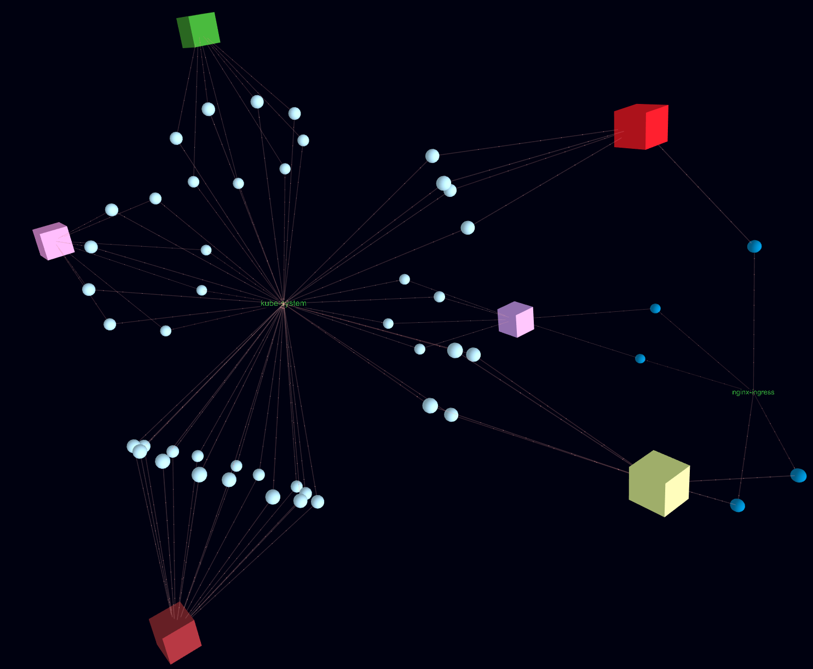

# kube-universe


---



## Overview

Kube-Universe renders a Kubernetes cluster into a dynamic 3D graph. An example landscape visualization can be found [here](images/universe.png).

A __Live Demo Version__ is available [here](https://afritzler.github.io/kube-universe/web/demo/)

## Features

* 3D cluster overview
* Identify pods with errors

## Installation and Usage

Before you start you need to install `statik` to vendor the web content into executable

```bash
go get -u github.com/rakyll/statik
```

Get the `kube-universe` binary

```bash
go get github.com/afritzler/kube-universe
```

Start `kube-universe` locally

```bash
kube-universe serve --kubeconfig=PATH_TO_MY_KUBECONFIG
```

or just

```bash
kube-universe serve
```

if you are using minikube or have the `KUBECONFIG` environment variable pointing to a corresponding cluster.

The web UI can be accessed via http://localhost:3000 and the rendered graph under http://localhost:3000/graph.
With the `--port` flag you can also specify under which port the kube universe server should be exposed (default is 3000).

## Development

## Installation

### Using `go install` (Go 1.16+)

```bash
go install github.com/afritzler/kube-universe@latest
```

### Using Docker

```bash
docker run -it --rm -v $HOME/.kube/config:/root/.kube/config ghcr.io/afritzler/kube-universe:latest serve
```

## Usage

Start `kube-universe` locally:

```bash
kube-universe serve --kubeconfig=PATH_TO_KUBECONFIG
```

If you are using a local cluster (like minikube or kind) or have the `KUBECONFIG` environment variable set, you can simply run:

```bash
kube-universe serve
```

The web UI will be accessible at `http://localhost:3000`, and the raw JSON graph at `http://localhost:3000/graph`.
You can change the default port using the `--port` flag (default is `3000`).

## Development

To build and run `kube-universe` from source:

```bash
git clone https://github.com/afritzler/kube-universe.git
cd kube-universe
go run . serve --kubeconfig=PATH_TO_KUBECONFIG
```

Or build the binary:
```bash
make
./kube-universe serve --kubeconfig=PATH_TO_KUBECONFIG
```

To build the Docker image locally:
```bash
make docker-build
```

## Acknowledgements

Kube universe is using [3d-force-graph](https://github.com/vasturiano/3d-force-graph) for rendering.
